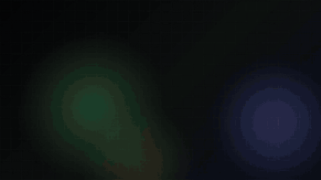
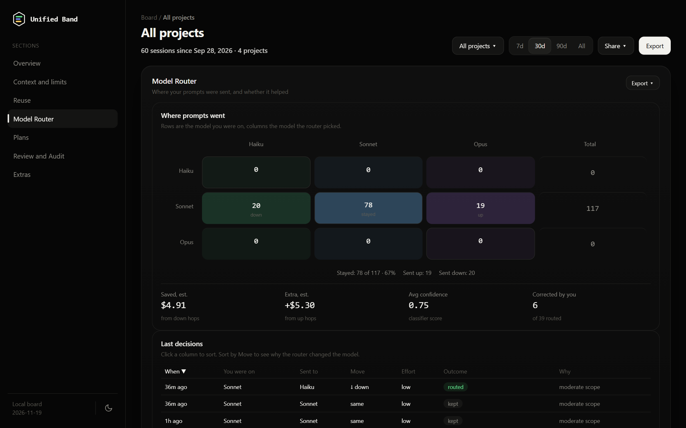
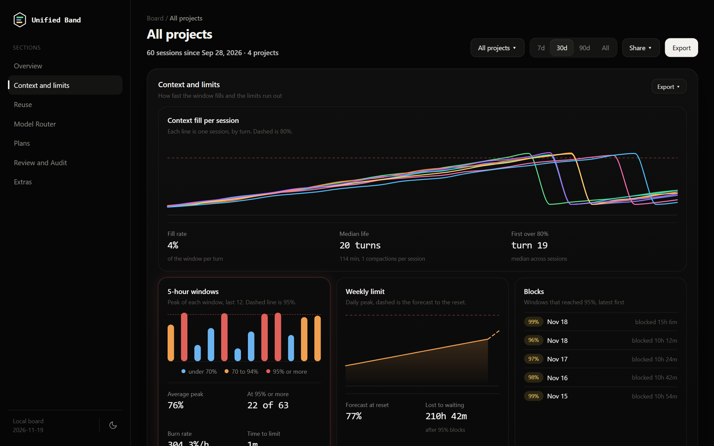
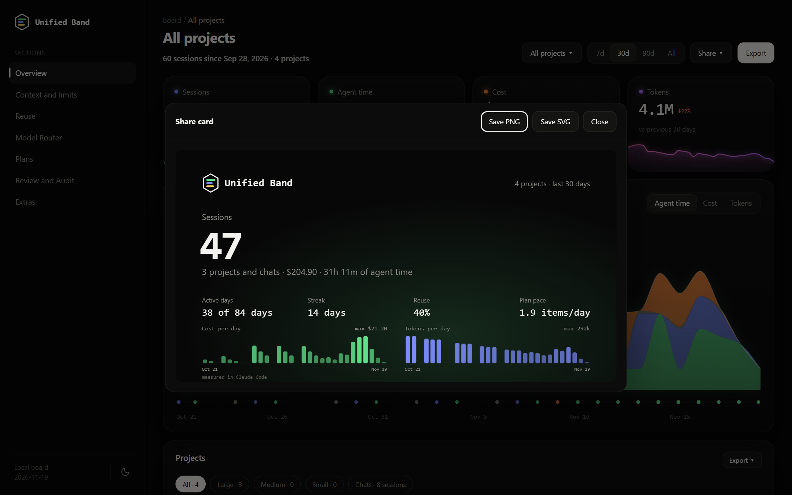
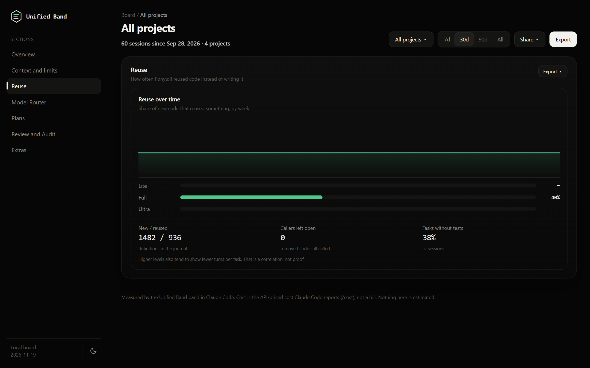
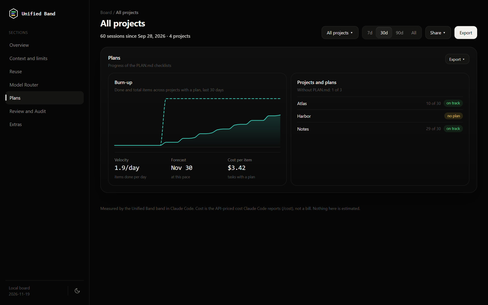
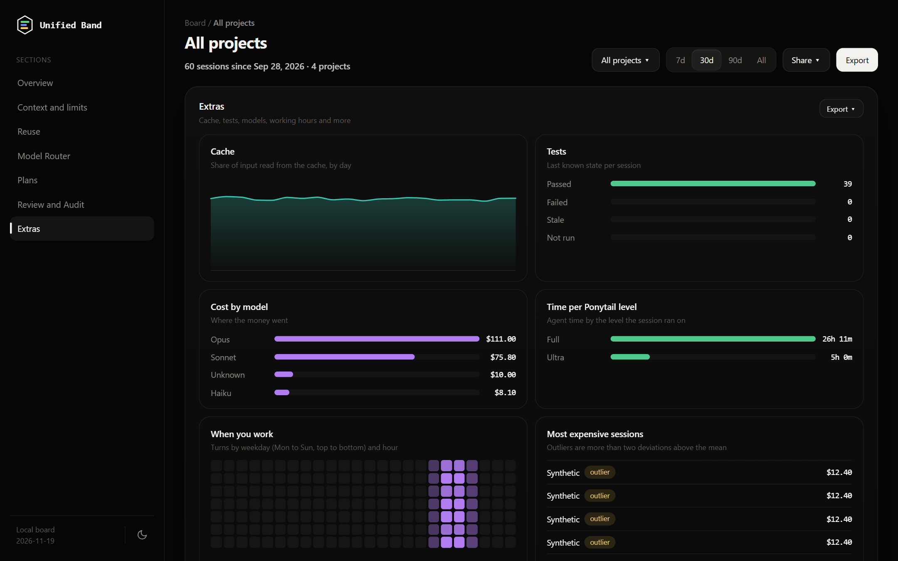

<h1 align="center">Unified Band</h1>

<p align="center">
  One band above the Claude Code prompt, <a href="https://github.com/DietrichGebert/PonyTail">Ponytail</a> built in,<br>
  and a local Board that shows where your time, tokens and money went.
</p>

<p align="center">
  <a href="https://github.com/Dgrabovets/UnifiedBand/actions/workflows/ci.yml"></a>
  <a href="LICENSE"></a>
  
  
</p>

<p align="center">
  
</p>

<p align="center"><sub>A 30 second tour, drawn from invented demo data. <a href="docs/demo.mp4">Watch it as a sharper video</a>.</sub></p>

## Why

Two add-ons had grown over the same prompt, each with its own buttons and numbers, and neither could tell you how a session went. Unified Band replaces both with one mod:

- **The band** is a single, tidy strip above the prompt: Ponytail level, cost, tokens, tests, limits, the model router and how far along your plan is.
- **The Board** is a local dashboard built from what the band records: per-project statistics, context and limits, the router's decisions, plans, reviews and more. No server, no network, no account.

## Quick start

```
/plugin marketplace add Dgrabovets/UnifiedBand
/plugin install unified-band@dgrabovets-plugins
```

Then disable the original Ponytail plugin (this mod contains its code, and both together double every hook) and restart Claude Code. Press **Board** on the band to open the dashboard.

Built and tested on Claude Code 2.1.302. The band needs a build with mod support; without it only the Ponytail hooks and skills load.

## The band

- **Level buttons**: Off, Lite, Full, Ultra. The current level is highlighted.
- **Action buttons**: Review, Audit, Board and Compact.
- **Info lines**: folder, branch, session age, prompt count and cost; last turn duration, model, cache hit rate, idle time and compactions.
- **Cards** that stretch to fill each row: Branch, Cost, Tokens, Agent Time, Reuse, Callers, Tests, Context, 5-Hour Limit, Weekly Limit and Project Completion.
- **Toasts** when a usage limit crosses 80% and 95%.

Project Completion is the share of checked boxes in a Markdown checklist (`- [x]` over all `- [ ]` and `- [x]` lines). The file is `PLAN.md` at the repo root; change it with the `progressFile` option. The card is hidden when the file is missing.

## The Board

Press **Board** and a single local page opens, rebuilt from the task ledger, the event journal and the model router's log every time.

<table>
  <tr>
    <td width="50%"><a href="docs/images/overview.png"></a><br><b>Overview</b><br>Sessions, agent time, cost and tokens, a stacked chart by project, and the Activity honeycomb. Pick 7d, 30d, 90d or All.</td>
    <td width="50%"><a href="docs/images/router.png"></a><br><b>Model Router</b><br>A matrix from your model to the one the router picked, a savings estimate, and a sortable list of decisions with a Move column.</td>
  </tr>
  <tr>
    <td width="50%"><a href="docs/images/context.png"></a><br><b>Context and limits</b><br>Context fill curves, life before a compaction, 5-hour window peaks, burn rate and a weekly forecast.</td>
    <td width="50%"><a href="docs/images/share-card.png"></a><br><b>Share card</b><br>A poster of your month: sessions, cost, active days, streak and two panels with cost and tokens per day.</td>
  </tr>
</table>

### Everything on the Board

- **Overview**: four cards with sparklines, a stacked chart that morphs between Agent time, Cost and Tokens, the Activity honeycomb, and the period switch.
- **Projects**: one table that is also the chart legend. A click on a row shows or hides a project. Filters pick a category (Large, Medium, Small, Chats), scored from turns, cost, sessions, days of work and whether a project has a `PLAN.md`. A Large project opens its own page with every section filtered to it.
- **Context and limits**, **Reuse** (how well Ponytail keeps code small), **Model Router**, **Plans** (burn-up, velocity, projects without a plan), **Review and Audit**, and **Extras** (cache, tests, cost by model, working hours, expensive sessions, push backs, subagents).
- **Chats**: ad hoc chats (the app's `spare-*` and `scratch-*` folders, `sandbox`, a drive root) form one group, counted in sessions and never opened one by one.
- **Share** holds the Share card and Copy summary. **Export** opens a dialog: pick sections and options on the left, a format on the right (PDF, Markdown or Raw data), then Download.
- **Raw data** is one JSON with the ledger, the journal, the router log, the config and every section's numbers, with a schema, for sending to someone who will analyse it. It follows the sections you tick. Session titles are included only if you tick "Include session titles"; "Hide project names" masks the names.
- **Motion** is always on and turns off with the system "reduce motion" setting: numbers roll like a departures board, charts draw in, the honeycomb pops in as a wave, a limit close to its end breathes a red ring, and a streak of a week or more throws confetti once.

<details>
<summary>More screenshots</summary>

<br>

| Projects | Export dialog |
| --- | --- |
|  |  |
| **Reuse** | **Plans** |
|  |  |
| **Review and Audit** | **Extras** |
|  |  |

</details>

## Where the data lives

Everything is stored under `~/.config/ponytail/band` and never leaves your machine, unless you set a webhook URL in the plugin options (see [SECURITY.md](SECURITY.md)).

- **The ledger** is one CSV per project and session (`<project>-<session>.csv`, and `<project>-import.csv` from `/ponytail band import`). The Board merges them.
- **The event journal** is `events-YYYY-MM-DD-<session>.jsonl`, one file per session and day, with one line per turn, prompt, compaction, `/model` command, subagent turn and review or audit run. It never stores prompt text, only counts and flags. History starts the day the journal is first written.
- **The router's log** is read from `~/.claude/cache/router/audit.jsonl` when the auto-model-router plugin is installed.

### board.json

Optional, next to the journal. Rename a project, force its category, merge two folders into one project (`aliases`), add folders to the Chats group (`chats`) or rename the dashboard (`title`):

```json
{
  "title": "Unified Band",
  "projects": { "Atlas": { "label": "Atlas Web", "category": "Large" } },
  "aliases": { "atlas-old": "Atlas" },
  "chats": ["sandbox2"]
}
```

## Requirements

- Claude Code with mod support (hooks modules).
- Node.js on PATH (the mode hooks are Node scripts).

## Known limits

- The panel covers Ponytail's own row only after it has drawn once. If you see two panels after a reload, the cover hook did not run on your build.
- Buttons are text only: the `Button` element has no icon prop.
- The Board button builds and opens `~/.config/ponytail/band/board.html` from what has been recorded so far; before the first finished turn it shows an empty page.
- Type-checking with `tsc` was not run.

## Development

CI runs the same checks on every pull request and every push to `master` (`.github/workflows/ci.yml`): validate, the tests and a smoke test of the Board page.

```
claude plugin validate .
claude plugin test .
node scripts/smoke-board.mjs out.html
```

The smoke script builds the page from your real ledger plus a synthetic journal (or from synthetic sessions when you have none) and runs its script against a stand-in DOM. It needs Node 22.15 or later. See [CONTRIBUTING.md](CONTRIBUTING.md) before sending a change.

### Regenerating the screenshots and the video

The pictures above come from invented data, so no real project names appear in them. They are made with [Remotion](https://www.remotion.dev) and headless Chrome from the `demo/` folder, which is not part of the plugin:

```
cd demo
npm install
npm run board     # builds the demo Board page from invented data
npm run shots     # screenshots into docs/images
npm run render    # the video, docs/demo.mp4
npm run gif       # the GIF for this README, docs/demo.gif
npm run social    # the social preview, docs/images/social-preview.png
```

Chrome or Edge must be installed (set `CHROME_PATH` to use another browser).

## Credits

The mode, skills, hooks, task tracking and board come from [Ponytail](https://github.com/DietrichGebert/PonyTail) by DietrichGebert (MIT, see `LICENSE-PONYTAIL`). Changes: the state key and skill namespace are `unified-band`, the band is redrawn, and the mode tracker also answers `/unified-band:ponytail`.

## Licence

[MIT](LICENSE).
