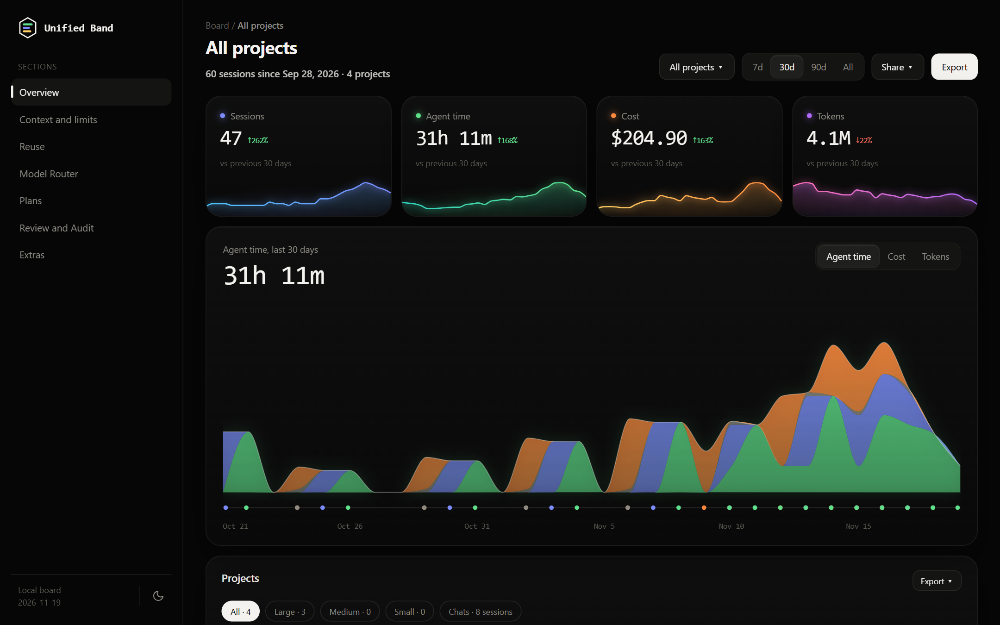
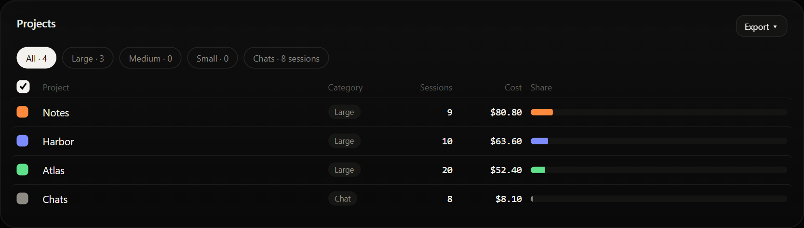
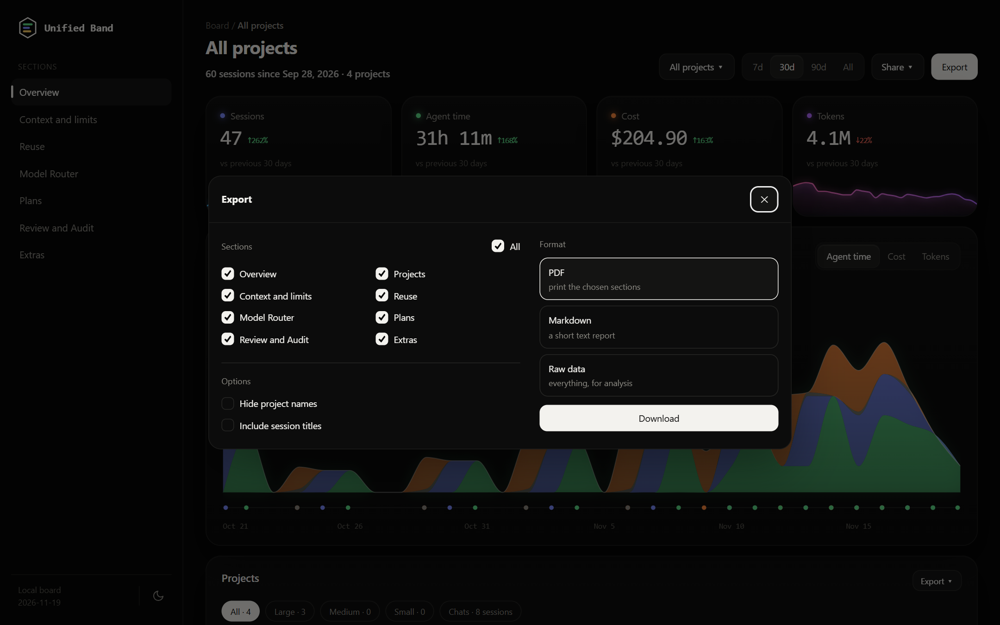
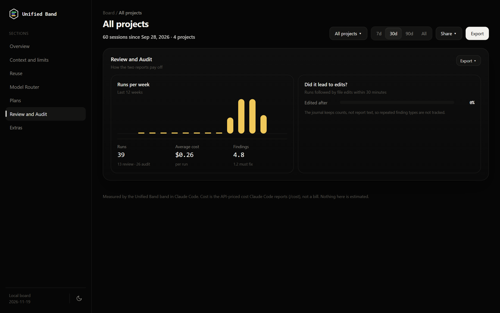

<p align="center"><picture><source media="(prefers-color-scheme: dark)" srcset="docs/images/header.svg"></picture></p>

<h1 align="center">Unified Band</h1>

<p align="center">
  <b>One Claude Code plugin instead of many</b>: one band above the prompt, <a href="https://github.com/DietrichGebert/PonyTail">Ponytail</a> and a model router built in,<br>
  and a local Board that shows where your time, tokens and money went.
</p>

<p align="center">
  <a href="https://github.com/Dgrabovets/UnifiedBand/actions/workflows/ci.yml"></a>
  <a href="LICENSE"></a>
  
  
</p>

https://github.com/user-attachments/assets/c0e00c6c-d970-44a4-9bf1-ab6f844daaa5

<p align="center"><sub>A one minute tour, recorded from the real Board with invented demo data. <a href="docs/demo.mp4">Open the full quality video</a>.</sub></p>

## One plugin instead of many

A usual Claude Code setup grows into a pile: a status line here, a usage tracker there, a Ponytail plugin for lean code, a model router, a separate dashboard. Each has its own install, its own buttons, its own numbers, and they fight over the same space above the prompt.

Unified Band puts them in one place, behind one interface:

| You used to install | In Unified Band |
| --- | --- |
| A status line | **The band** above the prompt: Ponytail level, branch, session age, context and limits, tests, reuse, the router's last decision and plan progress in one strip |
| A usage and limit tracker | **Context and limit meters** with reset times, warnings at 80% and 95%, cost and tokens on the Board, and its **Context and limits** section |
| [Ponytail](https://github.com/DietrichGebert/PonyTail) for lean code | **Built in**: levels, skills, task tracking and the task ledger |
| [auto-model-router](https://github.com/IuriiTurok/auto-model-router) or another model router | **Built in**: the classifier, worker agents, routing skills and the **Model Router** section (see [Model router](#model-router)) |
| A dashboard of past sessions | **The Board**: projects, cost by model, reuse, plans, reviews, extras |

One install, one set of buttons, one place to look. And it keeps growing: the band takes new cards, the Board takes new sections, and the same recorded data feeds both, so a new feature costs no extra setup.

- **The band** is a single, tidy strip above the prompt.
- **The Board** is a local dashboard built from what the band records and what the router logs. No server, no network, no account.
- **The model router** sends a prompt to a cheaper worker agent when one can do the work.

## Quick start

```
/plugin marketplace add Dgrabovets/UnifiedBand
/plugin install unified-band@dgrabovets-plugins
```

Then disable the original Ponytail plugin (this mod contains its code, and both together double every hook) and restart Claude Code. The separate `auto-model-router` plugin is no longer needed: while it is enabled, the built-in router steps back. Press **Board** on the band to open the dashboard.

Built and tested on Claude Code 2.1.302. The band and the Board need a build with mod support; without it only the Ponytail and router command hooks and the skills load.

## The band

- **Level buttons**: Off, Lite, Full, Ultra. The current level is highlighted.
- **Action buttons**: Review, Audit, Router, Board and Compact. Compact leaves only the buttons.
- **Router** opens the router review in place of the session lines and meters, and closes it on the next press: two lines on the last 30 days: how many routing orders really ran on a worker and what they saved, and what all router workers (started by an order or by name) saved or cost against the session's model. The figures are an estimate from the workers' own token counts, worked out on your machine from the router's log and the journal, with no model call and no tokens. The review also refreshes when a session starts and when the Board is opened, and the Model Router fact then leads with what all workers saved or cost.
- **Session**: the branch (or the folder), session age and prompt count.
- **Meters**: Context, 5-Hour Limit and Weekly Limit, the two limits with their reset times.
- **Facts**: Tests, Reuse (with callers left open), Model Router (the last decision of this session) and Project (plan progress).
- **Toasts** when a usage limit crosses 80% and 95%.

A short window drops the facts first, then the meters. Cost, tokens and agent time are recorded too and shown on the Board.

Project is the share of checked boxes in a Markdown checklist (`- [x]` over all `- [ ]` and `- [x]` lines). The file is `PLAN.md` at the repo root; change it with the `progressFile` option. It shows N/A when the file is missing.

## The Board

Press **Board** and a single local page opens, rebuilt from the task ledger, the event journal and the model router's log every time.

<table>
  <tr>
    <td width="50%"><a href="docs/images/overview.png"></a><br><b>Overview</b><br>Sessions, agent time, cost and tokens, a stacked chart by project, and the Activity honeycomb. Pick 7d, 30d, 90d or All.</td>
    <td width="50%"><a href="docs/images/router.png"></a><br><b>Model Router</b><br>What the router's workers saved or cost, a matrix from your model to the one the router picked, and a sortable list of decisions with a Move column.</td>
  </tr>
  <tr>
    <td width="50%"><a href="docs/images/context.png"></a><br><b>Context and limits</b><br>Context fill curves, life before a compaction, 5-hour window peaks, burn rate and a weekly forecast.</td>
    <td width="50%"><a href="docs/images/share-card.png"></a><br><b>Share card</b><br>A poster of your month: sessions, cost, active days, streak and two panels with cost and tokens per day.</td>
  </tr>
</table>

### Everything on the Board

- **Overview**: four cards with sparklines (Sessions, Agent time, Cost, Tokens), a stacked chart by project that morphs between Agent time, Cost and Tokens, the Activity honeycomb, and the period switch 7d, 30d, 90d, All.
- **Projects** (on the Overview page, above Activity) is one table that is also the chart's legend: a click on a row shows or hides a project. Filters pick a category (Large, Medium, Small, Chats), scored from turns, cost, sessions, days of work and whether a project has a `PLAN.md`. A Large project opens its own page with every section filtered to it.
- **Context and limits**: context fill curves, fill rate, life before compaction, 5-hour window peaks, burn rate, weekly forecast, blocks.
- **Reuse** (how well Ponytail keeps code small), **Plans** (burn-up, velocity, projects without a plan), **Review and Audit**, and **Extras** (cache, tests, cost by model, working hours, expensive sessions, push backs, subagents).
- **Model Router**: savings measured from the workers' tokens against the same tokens on the session's model (orders that ran, and all router workers), the matrix, a router report (corrections routed against kept, time to result, workers and their tokens, tier mix, tips) and the last decisions with the reason for each. Shadow mode rows show as "would route".
- **Pages**: the sections are tabs, one page at a time. A project switcher in the header picks all projects or one of the large ones.
- **Chats**: ad hoc chats (the app's `spare-*` and `scratch-*` folders, `sandbox`, a drive root) form one group, counted in sessions and never opened one by one.
- **Share** holds the Share card and Copy summary, a short Markdown report on the clipboard. **Export** opens a dialog: pick sections and options on the left, a format on the right (PDF, Markdown or Raw data), then Download. Every section also has its own Export (PDF, Markdown, CSV). PDF opens the browser's print dialog: choose "Save as PDF".
- **Raw data** is one JSON with the ledger, the journal, the router log, the config and every section's numbers, with a schema, for sending to someone who will analyse it. It follows the sections you tick. Session titles are included only if you tick "Include session titles"; "Hide project names" masks the names.
- **Motion** is always on and turns off with the system "reduce motion" setting: numbers roll like a departures board, charts draw in, the honeycomb pops in as a wave, a limit close to its end breathes a red ring, and a streak of a week or more throws confetti once.

The dashboard is called Unified Band, with a hexagon-and-bars mark of its own.

<details>
<summary>More screenshots</summary>

<br>

| Projects | Export dialog |
| --- | --- |
|  |  |
| **Reuse** | **Plans** |
|  |  |
| **Review and Audit** | **Extras** |
|  |  |

</details>

## Model router

A prompt hook classifies every prompt (tier and effort) with heuristics. When the chosen tier is strictly cheaper than the session's own model, the prompt is delegated to a worker agent (`unified-band:router-haiku`, `-sonnet`, `-opus`, `-fable`). Plan-mode and multi-part prompts fan out in parallel waves that never write the same file (skills `auto-model-routing` and `plan-with-models`). Hooks on Agent calls, subagent stops and turn ends write the outcomes to `~/.claude/cache/router/audit.jsonl`, the same log and line format the original wrote; the band and the Board read it. One difference: a worker that is continued gets a second `worker_usage` row with its larger totals. The Board counts only the newest; the original's reports would count both.

- Skills: `/unified-band:route <prompt>` shows how a prompt classifies, `/unified-band:route-status` lists recent decisions.
- Russian: unlike the original, which knew English words only, the classifier also reads Russian task words (rewrite, refactor, implement, design, investigate, "show me", "for each" and so on), so a hard Russian task is not mistaken for a moderate one. `tests/router-russian.test.ts` keeps the rule that a Russian prompt gets the decision of its English translation.
- Opt out: add `#noshift` or `#noroute` to a prompt, set `CC_ROUTER_DISABLE=1`, or put `{"disabled": true}` in `router.json`. `#model=haiku|sonnet|opus|fable` forces a worker. Rules and a default model go in `.claude/router.json` (project) or `~/.claude/router.json` (global): `{"default_model": "sonnet", "rules": [{"match": "typo", "model": "haiku", "reason": "cheap"}]}`. A rule with `"regex": true` is a JavaScript regular expression now.
- Shadow mode: `CC_ROUTER_SHADOW=1` or `{"shadow": true}` in `router.json` logs what the router would do and changes nothing; the Board shows those rows as "would route".
- Two guards beyond the original: a prompt that points back at earlier turns ("that function we discussed", "as before") or pastes a failure (a stack trace, a compiler error) stays on your model, because a cheaper worker would start without that context. `#model=` is never held back by them.
- Settings by environment: `CC_ROUTER_CACHE_DIR`, `CC_ROUTER_GLOBAL_CONFIG`, `CC_ROUTER_ROUTE_FLOOR`, `CC_ROUTER_CTX_WARN`, `CC_ROUTER_AUDIT_MAX_BYTES`, `CC_ROUTER_AUDIT_RETAIN_DAYS`. The cache folder is under `CLAUDE_CONFIG_DIR` when that is set, else `~/.claude`.
- **Both installed:** when the original `auto-model-router` plugin is enabled (`enabledPlugins` in the user, project or local settings), every router hook here does nothing and the original keeps working, so nothing runs twice. Disable it to switch to the built-in router.
- Not ported: `/router-report`, `tools/usage-report.py`, `tools/analyze-audit.py`, `tools/replay_session_pivot.py`, `bin/cc-route` and the price table. They are reporting and launcher tools built on 1,500 lines of Python; the Board's Model Router page, with its router report, covers decisions, corrections, workers and estimated savings.
- Heuristic routing picks Opus or Sonnet, and only a cheaper model than the session's is ever ordered. On a Sonnet session nothing is therefore routed automatically unless a `router.json` rule, `#model=` or a lower `CC_ROUTER_ROUTE_FLOOR` (below 0.55) sends it to Haiku.

The classifier is checked against the Python original: `tests/router-fixture.ts` holds 232 prompt cases generated from it, and `node scripts/router-differential.mjs <original plugin folder> --hooks` runs both implementations end to end.

## Where the data lives

The Board's own data is under `~/.config/ponytail/band`, and the router's log under `~/.claude/cache/router`. Nothing leaves your machine, unless you set a webhook URL in the plugin options (see [SECURITY.md](SECURITY.md)).

- **The ledger** is one CSV per project and session (`<project>-<session>.csv`, and `<project>-import.csv` from `/ponytail band import`). The Board merges them. Rows an earlier version wrote without a model get it from the session's transcript: a hook does this in the background when a session starts. A session whose transcript is gone stays Unknown.
- **The event journal** is `events-YYYY-MM-DD-<session>.jsonl`, one file per session and day, with one line per turn, prompt, compaction, `/model` command, subagent turn and review or audit run. It never stores prompt text, only counts and flags. History starts the day the journal is first written.
- **The router's log** is `~/.claude/cache/router/audit.jsonl`, written by the built-in router (or by the original plugin while that one is enabled).

### board.json

Optional, next to the journal. Rename a project, force its category, merge two folders into one project (`aliases`), add folders to the Chats group (`chats`) or rename the dashboard (`title`):

```json
{
  "title": "Unified Band",
  "projects": { "Atlas": { "label": "Atlas Web", "category": "Large" } },
  "aliases": { "atlas-old": "Atlas" },
  "chats": ["sandbox2"]
}
```

## Requirements

- Claude Code with mod support (hooks modules).
- Node.js 18 or later on PATH (the mode and router hooks are Node scripts; there is no Python dependency).
- Disable the original Ponytail plugin: this mod contains its code, and both together double every hook.
- The model router is built in, so the separate `auto-model-router` plugin is no longer needed. If it is still enabled, the built-in router steps back (see [Model router](#model-router)).

## Known limits

- The router hooks are tested with scripted payloads (`scripts/router-edge.mjs`, and a comparison with the original); in a live session only a forced `#model=haiku` delegation was checked. `${CLAUDE_PLUGIN_ROOT}` in the `route` skills is not verified on every build.
- `/ponytail band off` has no effect on the band in this version. Use **Compact** to shrink it.
- The Board button opens the page with `start` on Windows and `xdg-open` elsewhere. Where `xdg-open` does not exist (macOS), open `~/.config/ponytail/band/board.html` by hand.
- Buttons are text only: the `Button` element has no icon prop.
- The Board button builds and opens `~/.config/ponytail/band/board.html` from what has been recorded so far; before the first finished turn it shows an empty page.
- Type-checking with `tsc` was not run.

## Development

CI runs the same checks on every pull request and every push to `master` (`.github/workflows/ci.yml`): validate, the tests, the router hook checks, the ledger repair check and a smoke test of the Board page.

```
claude plugin validate .
claude plugin test .
node scripts/router-edge.mjs
node scripts/repair-check.mjs
node scripts/smoke-board.mjs out.html
```

The smoke script builds the page from your real ledger plus a synthetic journal (or from synthetic sessions when you have none) and runs its script against a stand-in DOM. It needs Node 22.15 or later. The page it writes can hold your real project names, so do not commit it. See [CONTRIBUTING.md](CONTRIBUTING.md) before sending a change.

### The demo pictures

The screenshots, the animated picture and the video come from invented data, so no real project names appear in them. `DEMO=1 node scripts/smoke-board.mjs out.html` builds that demo page; the pictures were taken from it with headless Chrome and the video was made with [Remotion](https://www.remotion.dev). The tooling is not part of this repository.

## Credits

The mode, skills, hooks, task tracking and board come from [Ponytail](https://github.com/DietrichGebert/PonyTail) by DietrichGebert (MIT, see `LICENSE-PONYTAIL`). Changes: the state key and skill namespace are `unified-band`, the band is redrawn, and the mode tracker also answers `/unified-band:ponytail`.

The model router (classifier, hooks, worker agents, the routing and planning skills, `/route` and `/route-status`) comes from [auto-model-router](https://github.com/IuriiTurok/auto-model-router) 0.9.2 by iuriiturok (MIT, see `LICENSE-ROUTER`). Changes: the Python hooks are rewritten in Node, the workers and skills are named `unified-band:...`, and the report tooling is left out (see [Model router](#model-router)).

## Licence

[MIT](LICENSE).
